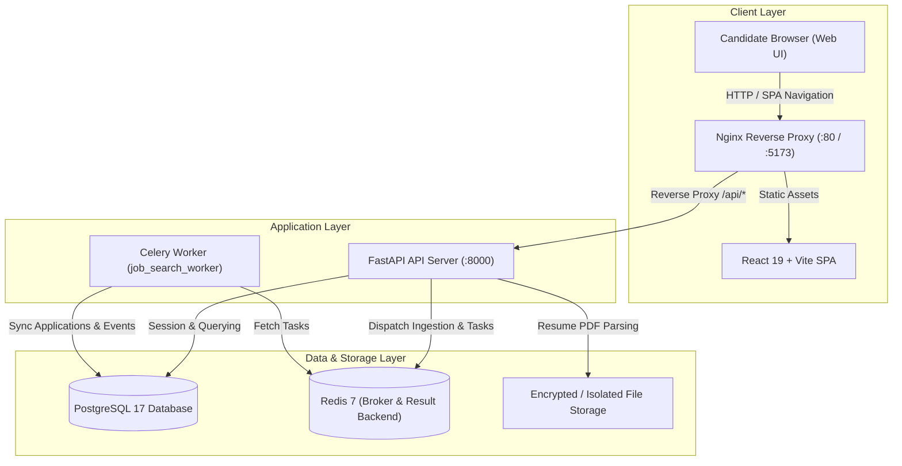

# Unified Job Search & Application Management System (v1.0.0)

A candidate-centric, production-grade career platform that connects job discovery, company verification, explainable skill matching, an interactive Kanban pipeline, recruitment email ingestion, and intelligent follow-up assistance into a unified workspace.

[](https://www.python.org/)
[](https://fastapi.tiangolo.com/)
[](https://react.dev/)
[](https://www.docker.com/)
[](LICENSE)
[]()

---

## 🏗️ Architecture Overview

The platform uses a layered, modular service architecture with asynchronous background task processing, an evidence-based verification engine, and candidate consent guardrails:



---

## 🛠️ Technology Stack

| Layer | Technologies |
|---|---|
| **Frontend** | React 19, Vite, JavaScript, React Router DOM, Axios, Lucide Icons, Error Boundary |
| **Backend** | Python 3.11/3.13, FastAPI, SQLAlchemy 2.0, Pydantic v2, PyJWT, Bcrypt, PyPDF, BeautifulSoup4 |
| **Asynchronous Engine** | Celery 5.3+, Redis 7 |
| **Database** | PostgreSQL 17 with Alembic Migrations |
| **Security** | Non-root containers, Cryptographic JWT, Bcrypt 72-byte salt hashing, Candidate Isolation |
| **DevOps / Containers** | Docker, Docker Compose, Multi-stage builds, Alpine base images, Nginx |

---

## 📁 Repository Directory Structure

```
unified-job-search/
├── docker-compose.yml         # Production multi-service orchestration
├── .env.example               # Secure environment variable template
├── alembic.ini                # Alembic database migration configuration
├── database/                  # Schema migrations & version tracking
│   └── migrations/            # Version-controlled migration revisions
├── docs/                      # Architectural specs & design guides
│   ├── architecture.md        # Detailed system design & component specification
│   ├── requirements.md        # Software requirement specification (SRS)
│   └── user-workflow.md       # Candidate user journey & workflow guide
├── backend/                   # FastAPI Backend
│   ├── Dockerfile             # Multi-stage non-root Python runtime
│   ├── docker-entrypoint.sh   # Automated migration & startup script
│   ├── requirements.txt       # Pinned production & test dependencies
│   ├── app/
│   │   ├── api/               # API routers (/auth, /profile, /jobs, /v1)
│   │   ├── core/              # Config, security, enums, exceptions
│   │   ├── db/                # Session factory & Base metadata
│   │   ├── models/            # SQLAlchemy declarative entities
│   │   ├── schemas/           # Pydantic request/response models
│   │   ├── services/          # Matching, verification, reminders, resume parsing
│   │   └── workers/           # Celery application & task handlers
│   └── tests/                 # 79 automated unit, integration, security & E2E smoke tests
└── frontend/                  # React + Vite Frontend
    ├── Dockerfile             # Multi-stage Vite build + Nginx runner
    ├── nginx.conf             # Nginx reverse proxy & SPA router fallback
    ├── package.json           # Node dependencies & scripts
    └── src/
        ├── components/        # ErrorBoundary, Navbar, ApiStatus, modals
        ├── pages/             # Dashboard, Profile, JobDiscovery, Tracker, EmailHub, RemindersHub
        ├── services/          # Centralized Axios API abstraction
        └── context/           # User authentication & session state
```

---

## 🚀 Deployment & Execution Guide

### Option 1: Containerized Deployment via Docker Compose (Recommended)

To spin up all services (PostgreSQL 17, Redis, FastAPI Backend, Celery Worker, and Nginx Frontend) with a single command:

```bash
# 1. Clone repository and switch to release branch
cd D:/unified-job-search

# 2. Configure environment variables
cp .env.example .env

# 3. Launch container stack
docker-compose up --build -d

# 4. Verify running container health
docker-compose ps
```

- **Frontend Application**: `http://localhost` (or `http://localhost:5173`)
- **FastAPI Interactive Swagger Docs**: `http://localhost:8000/api/docs`
- **ReDoc API Reference**: `http://localhost:8000/api/redoc`
- **Backend Health Check**: `http://localhost:8000/api/health`

---

### Option 2: Local Bare-Metal Development

#### 1. Backend Setup
```bash
cd backend
python -m venv .venv
# On Windows:
.venv\Scripts\activate
# On Linux/macOS:
source .venv/bin/activate

pip install -r requirements.txt
alembic upgrade head
uvicorn app.main:app --reload --port 8000
```

#### 2. Celery Worker (Optional for local async tasks)
```bash
celery -A app.workers.celery_app worker --loglevel=info
```

#### 3. Frontend Setup
```bash
cd frontend
npm install
npm run dev
```

---

## 🧪 Quality Gates & Automated Testing

### Backend Test Suite (Pytest)
Run the full 79-test regression and security suite:
```bash
cd backend
python -m pytest tests -v
```

**Test Coverage by Subsystem (79 Tests Passing)**:
- `test_auth_and_profile.py` (13 tests): Registration, duplicate rejection, login, JWT validation, profile updates, cookie security (`HttpOnly`, `SameSite=Lax`, `Secure`), Redis rate limiting, and candidate isolation.
- `test_resume_upload.py` (6 tests): PDF validation, MIME type enforcement, 5MB limit, skill extraction heuristics, and candidate skills review.
- `test_jobs.py` (16 tests): Discovered job CRUD, pagination, filtering, URL job import, and comprehensive SSRF defense suite (loopback, private subnets, cloud metadata `169.254.169.254`, credentialed URLs, DNS rebinding, hop-by-hop redirects, 2MB size cap, content-type checks, and timeouts).
- `test_verification_signals.py` (7 tests): Domain validation, MX DNS records, ATS careers verification, scam fee detection, Telegram interview fraud detection, and disposable domain detection.
- `test_matching_service.py` (6 tests): Exact and synonym technical matching, missing critical skill breakdown, experience gap weighting, and candidate ranking.
- `test_application_tracking.py` (6 tests): Direct application tracking, duplicate prevention, Kanban stage transition history, notes & timeline updates, metrics, and candidate isolation.
- `test_email_integration.py` (10 tests): Inbound email ingestion, automated interview/assessment detection, webhook secret header authentication, caller user-ID spoofing rejection, and scam warning flagging.
- `test_reminders_and_followup.py` (6 tests): Aging status engine, deadline alert scheduler, stage-differentiated follow-up drafter, and user isolation.
- `test_e2e_lifecycle.py` (3 tests): Complete candidate end-to-end integration smoke test from registration to follow-up draft, cross-tenant isolation, and production startup security validation (rejecting docker/env placeholders and default DB passwords).
- `test_health.py` (4 tests): Root health check, database ping, and error propagation.
- `test_v1_applications_and_verification.py` (3 tests): V1 route contract checks, verification endpoint, and email ingestion tasks.

### Frontend Quality Assurance
```bash
cd frontend
npm run lint    # Verifies zero warnings and zero errors via oxlint
npm run build   # Compiles production-ready Vite client bundle
```

---

## 📋 Comprehensive API Catalog

### Authentication (`/api/auth`)
- `POST /api/auth/register`: Register new candidate user account.
- `POST /api/auth/login`: Authenticate and issue signed JWT bearer token.
- `GET /api/auth/me`: Retrieve currently authenticated candidate profile.

### Candidate Profile & Resumes (`/api/profile`)
- `GET /api/profile`: Retrieve candidate profile and confirmed skills.
- `PUT /api/profile`: Update education, experience years, preferences, and target roles.
- `POST /api/profile/resume`: Upload PDF resume, extract plain text, and generate skill suggestions.
- `POST /api/profile/confirm-skills`: Approve extracted skills into candidate profile.

### Jobs & Discovery (`/api/jobs`)
- `GET /api/jobs`: Search, filter, and paginate active job opportunities.
- `POST /api/jobs`: Manually post or import a discovered job record.
- `POST /api/jobs/import-url`: Scrape and ingest job details from external career portal URL.
- `POST /api/jobs/{id}/verify`: Trigger evidence-based legitimacy audit and scam heuristic check.
- `POST /api/jobs/{id}/match`: Compute transparent explainable match breakdown against candidate.
- `GET /api/jobs/matches`: Rank all available jobs sorted by candidate match percentage.
- `POST /api/jobs/{id}/apply`: 1-Click transfer from discovery into active Kanban tracker.

### Kanban Application Tracker (`/api/v1/applications`)
- `GET /api/v1/applications`: List tracked applications with stage and source platform filters.
- `POST /api/v1/applications`: Manually track an external job application.
- `GET /api/v1/applications/metrics`: Aggregate pipeline counts per stage.
- `GET /api/v1/applications/{id}`: Detailed view with company metadata and timeline events.
- `PATCH /api/v1/applications/{id}/stage`: Transition pipeline stage with audit notes.
- `PUT /api/v1/applications/{id}/details`: Update recruiter contacts, interview dates, and test deadlines.
- `DELETE /api/v1/applications/{id}`: Delete application record.

### Email Intelligence Hub (`/api/v1/emails`)
- `POST /api/v1/emails/ingest`: Inbound webhook endpoint for incoming recruitment emails.
- `GET /api/v1/emails`: Retrieve parsed recruitment communications.
- `POST /api/v1/emails/{id}/link-application`: Manually associate an email with a pipeline application.

### Reminders & Follow-Up Drafter (`/api/v1/reminders`)
- `GET /api/v1/reminders/alerts`: Retrieve prioritized actionable alerts (deadlines, interviews, stalled leads).
- `POST /api/v1/reminders/draft-followup/{id}`: Synthesize context-aware, polite email draft (Polite, Professional, Firm).
- `POST /api/v1/reminders/log-followup/{id}`: Record follow-up outreach in application timeline.

---

## 🔒 Security Best Practices & Guardrails

1. **Strict Candidate-Consent Enforced**: The system **never** automatically sends emails or alters candidate pipelines without human review. All follow-up actions require explicit user review, customization, and candidate dispatch.
2. **Production Startup Hardening**: In `production` mode, the application terminates immediately on startup if `SECRET_KEY` is missing, short (<32 characters), or matches placeholder strings (including docker and env templates), or if default database passwords (`postgres`, `password`, `root`) are detected.
3. **Comprehensive SSRF Mitigation Engine**: All user-supplied job import URLs undergo strict protocol verification (`http`/`https`), DNS resolution checks blocking loopback (`127.0.0.0/8`, `::1`), private RFC 1918 subnets, link-local / cloud metadata endpoints (`169.254.169.254`, `fe80::`), credential stripping, hop-by-hop redirect verification (max 3 hops), finite 5-second timeouts, and a strict 2 MB response size limit.
4. **Email Webhook Ingestion Protection**: Inbound recruitment email endpoints require either an active authenticated candidate session or a valid `X-Webhook-Secret` header matching `settings.WEBHOOK_SECRET`. Authenticated candidate requests strictly scope the ingestion to `user.id`, preventing caller user-ID spoofing.
5. **Secure Cookie & Session Lifecycle**: Authentication cookies use `HttpOnly`, `SameSite=Lax`, environment-aware `Secure` attributes, and full expiration upon logout. Frontend clients automatically clear stale session tokens on HTTP 401.
6. **Abuse Prevention & Rate Limiting**: Critical endpoints (`/api/auth/login`, `/api/auth/register`, `/api/jobs/import-url`) are protected by a Redis-backed fixed-window rate limiter with graceful fail-open resilience when Redis is unavailable.
7. **Database Transaction Safety**: Request database sessions automatically perform `db.rollback()` on unhandled exceptions prior to cleanup, preventing partial commit corruption.
8. **Cross-Tenant Isolation**: Candidate data is strictly isolated by foreign key constraints and dependency authentication (`current_user.id`). Unauthorized cross-tenant queries return `403 Forbidden` or `404 Not Found`.
9. **Least-Privilege Containerization**: Docker containers run under a non-root system user (`appuser` with UID 1000).

---

## 🗺️ Feature Status & External Integration Roadmap

| Subsystem | Current Implementation Status | External Requirements / Roadmap |
|---|---|---|
| **Job Discovery & URL Import** | ✅ Implemented (Manual CRUD, filtering, secure SSRF-protected URL HTML parser) | 📋 Planned: Direct LinkedIn / Indeed scraper APIs (requires third-party API credentials) |
| **Legitimacy Verification Signals** | ✅ Implemented (DNS/MX inspection, ATS career URL matching, fee/telegram scam heuristics) | 📋 Fully operational without external paid APIs |
| **Explainable Job Matching** | ✅ Implemented (Normalized exact/synonym skill matching, critical gaps, experience delta) | 📋 Fully self-contained local matching algorithm |
| **Kanban Application Tracking** | ✅ Implemented (7-stage pipeline, metrics, activity notes, timeline audit, duplicate warnings) | 📋 Fully self-contained PostgreSQL persistence |
| **Recruitment Email Hub** | ✅ Implemented (Signed webhook ingestion, candidate session ingestion, category parser) | 📋 Planned: Live background Gmail / IMAP mailbox sync (requires Google OAuth client credentials) |
| **Reminders & Follow-Up Drafter** | ✅ Implemented (Aging status engine, deadline alerts, stage/tone-differentiated drafting) | 📋 Strict candidate-consent: No automated dispatch without candidate action |

---

## 📜 GitFlow Release Documentation

This codebase adheres to standard GitFlow branching conventions:
- **`main`**: Production-ready releases tagged with Semantic Versioning (e.g. `v1.0.0`).
- **`develop`**: Integration branch containing all completed, tested phases.
- **`feature/*`**: Isolated feature branches corresponding to project milestones:
  - `feature/phase-1-foundation`
  - `feature/phase-2-database-api`
  - `feature/phase-3-auth-profile`
  - `feature/phase-4-resume-upload-extraction`
  - `feature/phase-5-job-discovery`
  - `feature/phase-6-explainable-matching`
  - `feature/phase-7-verification-signals`
  - `feature/phase-8-application-tracking`
  - `feature/phase-9-email-integration`
  - `feature/phase-10-reminders-followup`
  - `feature/phase-11-release-hardening` (Current)

---

## 📄 License
This project is open-source and released under the [MIT License](LICENSE).
