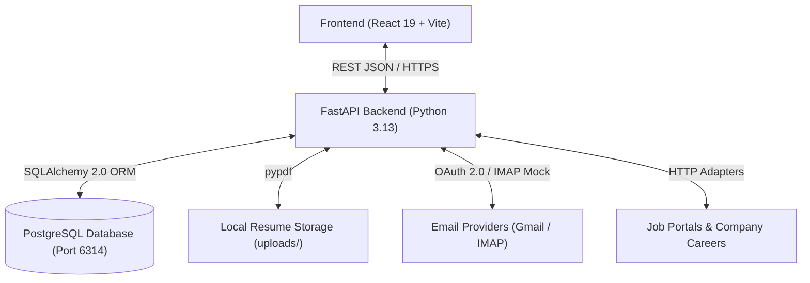

# System Architecture: Unified Job Search & Application Management System

## 1. High-Level Architecture Overview

The system follows a clean modular monolithic 3-tier architecture designed for clarity, maintainability, and academic presentation:

## 2. Component Breakdown

### Frontend (`frontend/`)
- **Technology**: React 19, Vite, JavaScript, React Router DOM, Axios, Lucide Icons.
- **Responsibility**: User interaction, authentication token storage, dashboard data visualization, resume upload flow, job discovery & matching interface, verification audit view.

### Backend (`backend/app/`)
- **Core (`app/core/`)**: Configuration settings via `pydantic-settings`, JWT authentication & token management, password hashing.
- **Database (`app/db/`)**: SQLAlchemy engine, session management, base model.
- **Models (`app/models/`)**: Declarative SQLAlchemy models representing users, candidate profiles, resumes, jobs, applications, verification evidence, and reminders.
- **Schemas (`app/schemas/`)**: Pydantic request and response models enforcing strict validation and typing.
- **API Routes (`app/api/routes/`)**: REST controllers organized by domain (`auth`, `profile`, `resumes`, `jobs`, `matching`, `verification`, `applications`, `reminders`).
- **Services (`app/services/`)**: Business logic layer (scoring algorithms, resume parsing, verification rule engine).

### Database (`database/`)
- **Technology**: PostgreSQL 17 (Running locally on port 6314).
- **Tooling**: Alembic migrations (`database/migrations/`).
- **Data Integrity**: Foreign key constraints, UUID/integer primary keys, indexed query columns, timestamps.

## 3. Security & Student Project Best Practices
- Passwords hashed with `bcrypt` (never stored as plaintext).
- JWT bearer tokens with standard expiration.
- CORS restricted to known local frontend ports.
- Input validation on all endpoints with Pydantic.
- File upload restrictions (PDF only, max size 5MB).
- No hardcoded secrets; configuration loaded from `.env`.
