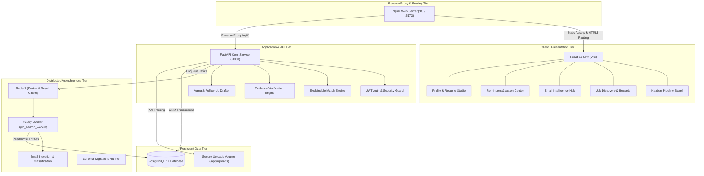
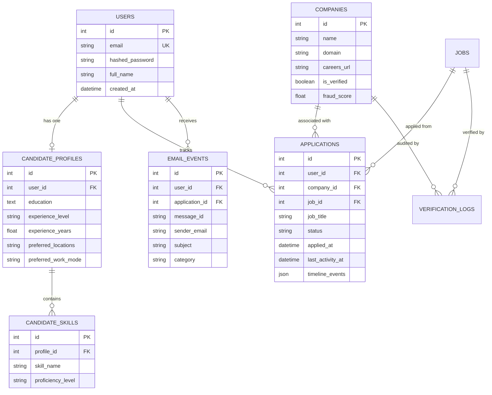

# System Architecture & Technical Specification: Unified Job Search (v1.0.0)

## 1. High-Level Architectural Topology

The Unified Job Search & Application Management platform is engineered as a production-grade, distributed web application. It combines synchronous REST APIs for high-responsiveness candidate interactions with asynchronous task workers for background scraping, verification audits, and inbound recruitment email ingestion.

---

## 2. Subsystem Deep-Dive

### 2.1 Authentication & Candidate Profile Subsystem
- **Standards**: OAuth2 password flow issuing signed JSON Web Tokens (JWT) using `HS256`.
- **Password Security**: Passwords hashed using `bcrypt` with unique cryptographic salting. Plaintext passwords never stored.
- **Candidate Profiles**: Persists structured candidate attributes (education, target roles, experience level, salary expectation, preferred work modes) alongside confirmed skill sets (`candidate_skills`).
- **Resume Extraction**: Accepts PDF resumes (enforcing MIME type `application/pdf` and <=5MB size limits). Extracts plain text via `pypdf`, matches technical keywords against curated tech taxonomy, and returns suggestions for explicit candidate confirmation.

### 2.2 Job Records & Discovery Engine
- **Job Ingestion**: Supports manual posting and direct URL scraping from company career sites.
- **Search & Filtering**: Multi-parameter SQL filtering by title keyword, technical skills, location, work mode (`Remote`, `Hybrid`, `On-site`), and company identifier with pagination.
- **Deduplication**: Checks normalized titles and URLs to prevent redundant records.

### 2.3 Transparent Explainable Matching Engine
- **Deterministic Delta Algorithm**: Evaluates candidate profile attributes against job requirements without black-box opacity.
- **Scoring Breakdown**:
  * **Required Technical Skills (60% weight)**: Exact and synonym normalization (e.g. `PostgreSQL` matches `Postgres`, `React.js` matches `React`).
  * **Preferred Skills (20% weight)**: Bonus score for secondary skills.
  * **Experience Alignment (20% weight)**: Compares confirmed candidate experience years against required job experience.
- **Explainability Output**: Generates human-readable summaries (`matched_skills`, `missing_critical_skills`, `experience_gap`, and actionable `resume_advice`).

### 2.4 Evidence-Based Company & Job Verification Engine
- **DNS / MX Record Validation**: Inspects recruiter domain existence and active mail exchange records to detect fraudulent domains.
- **Official Career Portal Matching**: Audits job URLs against known enterprise ATS systems (Greenhouse, Lever, Workday) and company domain career endpoints.
- **Scam Detection Heuristics**: Flags suspicious patterns including:
  * Upfront equipment or training fee demands.
  * Unsolicited job offers without interview stages.
  * Shift to unmonitored messaging apps (e.g. Telegram, WhatsApp).
  * URL shorteners hiding destination domains.
  * Free webmail addresses (e.g. `@gmail.com`, `@yahoo.com`) claiming to represent Fortune 500 corporations.

### 2.5 Kanban Application Tracking Pipeline
- **Lifecycle Enums**: `DRAFT` → `APPLIED` → `ASSESSMENT` → `INTERVIEW` → `OFFER` → `REJECTED` / `STALE`.
- **One-Click Application Tracking**: Instantly tracks discovered jobs into active candidate pipeline, automatically linking company records and logging initial application timeline event.
- **Timeline Audit History**: Chronological JSON event history recording stage progressions, interview appointments, test deadlines, recruiter contact details, and follow-up activities.

### 2.6 Asynchronous Recruitment Email Ingestion
- **Inbound Webhook**: Fast API endpoint accepting incoming email payloads (`sender`, `subject`, `body`, `date`, `user_id`).
- **Celery Worker Ingestion**: Classifies incoming recruitment emails into:
  * `APPLICATION_ACKNOWLEDGEMENT`
  * `ASSESSMENT_INVITATION` (extracts assessment deadlines)
  * `INTERVIEW_INVITATION` (extracts video meeting links and interview dates)
  * `REJECTION`
  * `SCAM_SUSPECTED`
- **Candidate Consent Guardrail**: Suggests stage transitions or updates interview details without destructively overwriting confirmed candidate data.

### 2.7 Reminders & Professional Follow-Up Drafter
- **Application Aging Engine**:
  * `RECENT` (< 3 days): Recently submitted or updated.
  * `FOLLOW_UP_SUGGESTED` (3–10 days): Silence detected; polite follow-up inquiry recommended.
  * `STALE_LEAD` (> 14 days): Long dormancy; candidate prompted to archive or submit final follow-up.
  * **Safety Invariant**: Under no circumstances does the engine automatically change status to `REJECTED` merely due to silence.
- **Context-Aware Drafter**: Generates personalized emails incorporating company name, job title, submission date, recruiter contact name, and candidate's confirmed technical strengths.
- **Tone Customization**:
  * *Polite & Enthusiastic*: Warm follow-up expressing enthusiasm.
  * *Professional & Balanced*: Standard status check on hiring timelines.
  * *Firm & Time-Sensitive*: Clarification inquiry noting competing interview timelines or scheduling windows.
- **Strict No-Auto-Send Policy**: Never sends emails autonomously. Provides drafts with `mailto:` pre-population and clipboard copy for candidate consent and control.

---

## 3. Production Hardening & Security Standards

1. **Defense-in-Depth Containerization**:
   - Multi-stage Docker builds separating compiler toolchains (`gcc`, `libpq-dev`, `npm`) from minimal Alpine runtime images.
   - Non-root user execution (`appuser` with UID 1000) inside backend containers.
2. **Environment Validation**:
   - `backend/app/core/config.py` enforces that in `ENVIRONMENT == "production"`, `SECRET_KEY` cannot be a default placeholder or shorter than 32 characters, and `DEBUG` must be `False`.
3. **Cross-Tenant Data Isolation**:
   - Every read and mutation query strictly filters by `user_id == current_user.id`.
   - Access attempts to cross-user application IDs or reminder drafts return `403 Forbidden` or `404 Not Found`.
4. **Resilient Frontend UI**:
   - `ErrorBoundary` catches unexpected rendering errors, displaying recovery controls without blanking the candidate workspace.
   - Nginx handles HTML5 client routing fallback via `try_files $uri $uri/ /index.html;`.

---

## 4. Database Schema Relationships

